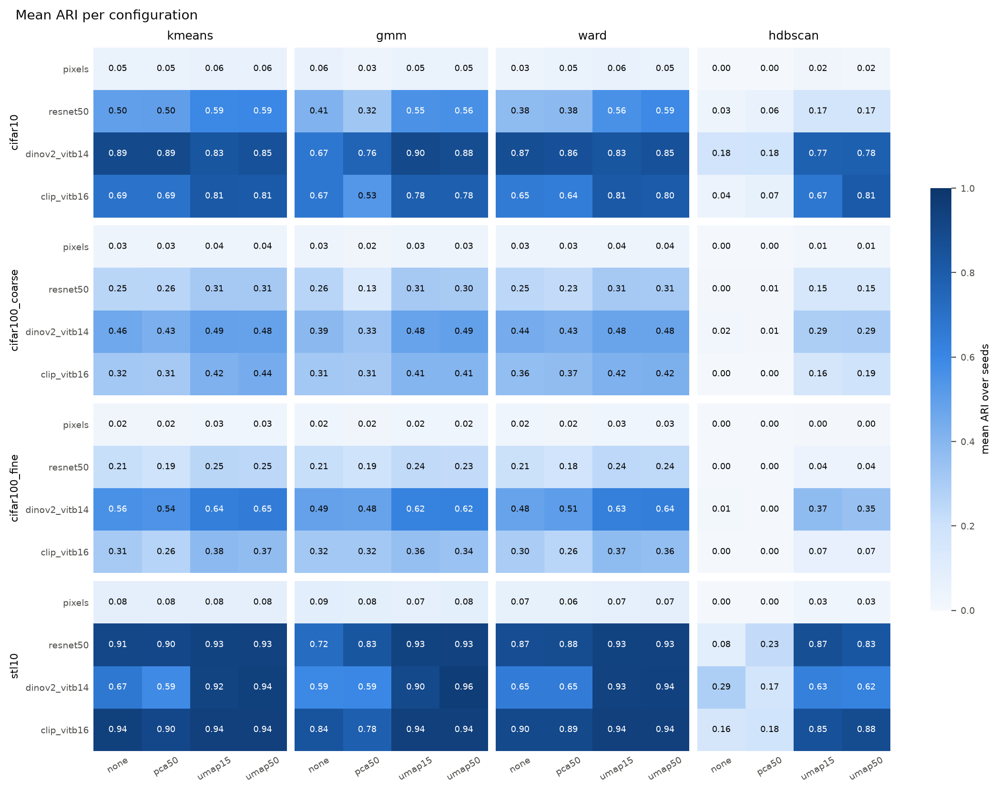
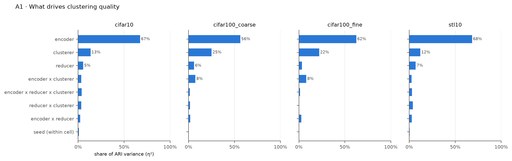
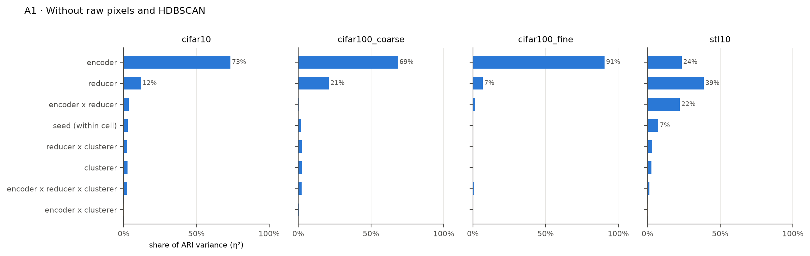
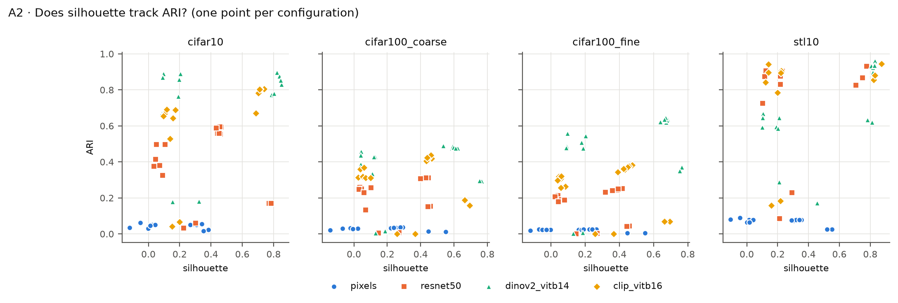
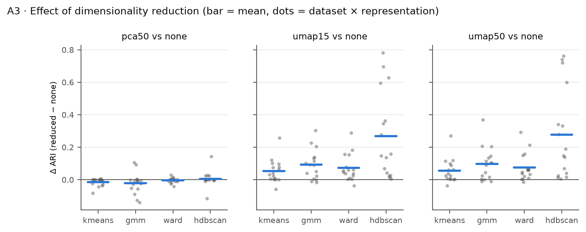

# Results

Full grid: 4 label sets × 4 representations × 4 reductions × 4 algorithms × 5 seeds = **1,280 runs**, run on the LAB150 cluster (RTX 4090 for feature extraction, CPU for clustering). All numbers below come from the frozen results table [`results/grid_runs.parquet`](results/grid_runs.parquet) and can be regenerated with:

```bash
uv run ffc analyze -c configs/grid.yaml --runs docs/results/grid_runs.parquet
```

ARI is the primary metric; "mean ARI" is the mean over the 5 seeds of a configuration.

## Integrity

- **1,280 / 1,280 unique runs, 0 failed.**
- The raw result file contained 322 duplicate records and 30 corrupt lines. A job was restarted by Slurm after a node failure while its first copy kept running, and both appended to the same file on a network filesystem.
  - 28 of the corrupt lines are not valid JSON.
  - 2 are *spliced*: the head of one record joined to the tail of another, which happens to parse. The reader rejects them because they repeat keys (a real writer never does) and because their run id disagrees with their own fields.
  - Every affected run has an intact record elsewhere in the file. The reader keeps one record per run.
- **320 of the 322 duplicate pairs are bit-identical.** The other two differ in the 4th decimal (multithreaded numerics).
- Since the incident, every process writes to its own file (`src/ffc/results.py`), so concurrent writers can no longer corrupt each other's lines.



**Best configuration per dataset**

| Dataset | Configuration | Mean ARI |
|---|---|---|
| CIFAR-10 | DINOv2 / UMAP15 / GMM | 0.897 |
| CIFAR-100 (20 superclasses) | DINOv2 / UMAP50 / GMM | 0.489 |
| CIFAR-100 (100 classes) | DINOv2 / UMAP50 / k-means | 0.646 |
| STL-10 | DINOv2 / UMAP50 / GMM | 0.960 |

## RQ1 · What drives clustering quality? (H1: representation)

Share of run-level ARI variance (η²) per factor, from a sum-of-squares decomposition of the full factorial. It is descriptive: no F tests, because deterministic cells (e.g. Ward without reduction) repeat the same result across seeds rather than giving independent replicates.

| Subset | Factor | CIFAR-10 | CIFAR-100 (20) | CIFAR-100 (100) | STL-10 |
|---|---|---|---|---|---|
| All runs | representation | 67.3% | 56.3% | 62.4% | 68.3% |
| | algorithm | 13.5% | 25.1% | 22.1% | 12.0% |
| | reduction | 5.5% | 6.0% | 3.2% | 7.0% |
| | seed | 0.8% | 0.3% | 0.1% | 0.5% |
| No raw pixels, no HDBSCAN | representation | 73.4% | 68.5% | 90.5% | 23.6% |
| | algorithm | 2.8% | 2.4% | 0.3% | 2.8% |
| | reduction | 12.0% | 21.1% | 6.8% | 38.8% |
| | seed | 3.0% | 1.8% | 0.1% | 7.5% |

**H1 is supported, conditionally.** The headline share is inflated by raw pixels (ARI ≈ 0 everywhere). The algorithm's share is inflated by HDBSCAN, which collapses without UMAP. Without those two extreme levels:
- Among k-means, GMM and Ward, the algorithm barely matters (≤ 3%).
- The representation dominates on CIFAR (69–91%).
- On STL-10 the reduction explains more than the representation (39% vs 24%): there, all three pretrained models are already good, and UMAP is what separates configurations.

The representation dominates when representations differ in quality for the domain.




## RQ2 · Can internal metrics choose without labels? (H2)

For each internal metric (oriented so higher = better), we computed:
- Kendall τ with ARI across all 64 configurations of a dataset (*global*);
- Kendall τ within each representation, averaged over representations (*within*);
- the **regret** of selecting by the metric: best ARI minus the ARI of the configuration it ranks first. A blind pick's expected regret is the reference.

| Subset | τ global | τ within | Regret (global) | Blind-pick regret |
|---|---|---|---|---|
| All algorithms | 0.12 – 0.43 | 0.15 – 0.43 | 0.00 – 0.30 | 0.25 – 0.43 |
| Without HDBSCAN | 0.33 – 0.56 | 0.38 – 0.64 | **0.00 – 0.07** | 0.21 – 0.37 |

**H2 as stated is not supported.** We expected internal metrics to fail when comparing representations, because they are computed in different spaces. At the level of the final choice, they did not:
- Without HDBSCAN, Silhouette, Davies-Bouldin and Calinski-Harabasz all pick a configuration within 0.07 ARI of the best. A blind pick loses 0.21–0.37.
- The space effect does show up in rank agreement, but only partly. Within-representation τ exceeds global τ for all three metrics on both CIFAR-100 label sets, and only for Calinski-Harabasz on CIFAR-10 and STL-10.

**The real failure mode is HDBSCAN.** With it included, the metrics pick an HDBSCAN + UMAP configuration in 7 of 12 (dataset, metric) cases:
- On CIFAR-100, Silhouette and Davies-Bouldin do so for both label sets, and Calinski-Harabasz for the 20 superclasses, losing 0.19–0.30 ARI.
- On CIFAR-10 and STL-10, Calinski-Harabasz does so, losing 0.08–0.09. Internal metrics ignore HDBSCAN's noise points, so a partition that discards the hard points looks better than one that assigns every point.

Internal metrics are a reasonable label-free selector among algorithms that assign every point, but not across partitions with different coverage.



## RQ3 · Does UMAP before clustering help, and for which algorithms? (H3)

Change in mean ARI relative to no reduction, over the 16 (dataset, representation) pairs:

| Reduction | k-means | GMM | Ward | HDBSCAN |
|---|---|---|---|---|
| PCA (50) | −0.015 | −0.022 | −0.004 | +0.006 |
| UMAP (10-d, 15 neighbors) | +0.053 | +0.093 | +0.072 | **+0.269** |
| UMAP (10-d, 50 neighbors) | +0.055 | +0.096 | +0.075 | **+0.276** |

**H3 is supported.** UMAP helps HDBSCAN more than k-means:
- with 15 neighbors, in 15 of 16 pairs (paired Wilcoxon p = 2.1 × 10⁻⁴);
- with 50 neighbors, in 16 of 16 pairs (p = 3.1 × 10⁻⁵).

PCA to 50 dimensions does not help any algorithm.

Part of the HDBSCAN gain is coverage:

| Reduction | Points kept by HDBSCAN | Clusters found |
|---|---|---|
| none | 21% | 6.3 |
| PCA (50) | 33% | 5.7 |
| UMAP15 | 83% | 24.5 |
| UMAP50 | 82% | 23.0 |

UMAP is not always beneficial. With DINOv2 on CIFAR-10, k-means drops from 0.891 (no reduction) to 0.831 (UMAP15).



## Other observations

- **No representation wins everywhere.** DINOv2 is best on every CIFAR label set. On STL-10, CLIP and ResNet-50 reach 0.91–0.94 with k-means even without reduction, while DINOv2 needs UMAP (0.67 → 0.94).
- **Seeds hardly matter.** The seed term is at most 7.5% of variance, and at most 0.8% over all runs.

## Limitations

- **ImageNet overlap.** STL-10 images are drawn from ImageNet, on which the ResNet-50 was trained *with labels*. DINOv2 and CLIP were pretrained on large web collections that may overlap with the evaluated images.
- **Known k.** k-means, GMM and Ward receive the true number of classes. HDBSCAN does not.
- **HDBSCAN's internal metrics** exclude noise points by construction, and its ARI counts noise as one extra group. Its results should be read next to coverage.
- **GMM precision.** 137 GMM runs were fitted in float32 (before the fix) and 183 in float64. The switch fixed a covariance collapse that stopped the first grid attempt; none of the float64 fits needed more than the default `reg_covar`.
- **Scope.** Test splits only (8–10k images per dataset); one UMAP setting besides `n_neighbors` (`min_dist = 0`, 10 dimensions); natural images only.
